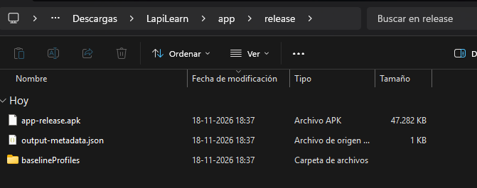
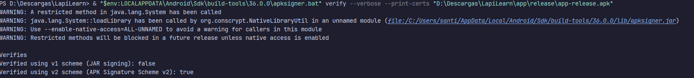
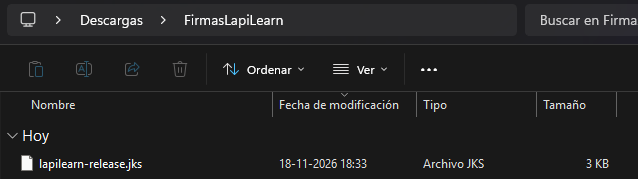
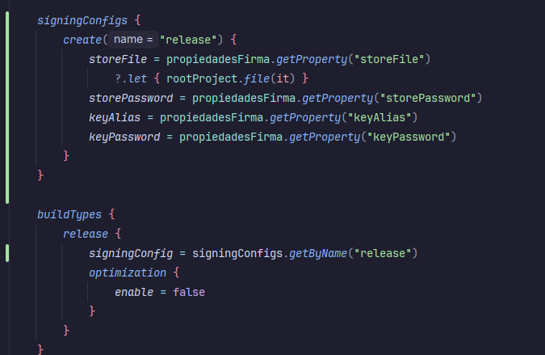

# LapiLearn

## Integrantes

- Santiago Matheo
- Vicente Aninao
- Elias Gonzales

## Contexto

LapiLearn es una aplicación móvil de apoyo a la nivelación de Lectura y Matemática para estudiantes de 1.º a 4.º básico. Está pensada para utilizarse dentro del establecimiento, bajo la supervisión de docentes y asistentes de aula.

## Problemática

Los estudiantes presentan distintos niveles de aprendizaje, por lo que necesitan actividades adecuadas a su curso y dificultad. Buscar, preparar y organizar estos ejercicios requiere tiempo. Además, es necesario registrar sus respuestas e intentos para orientar la práctica y el acompañamiento pedagógico.

## Solución

LapiLearn reúne la creación, asignación y resolución de actividades en una aplicación Android:

- El docente crea y edita actividades, incorpora preguntas, define instrucciones y habilita su disponibilidad.
- La asistente selecciona actividades disponibles y las asigna a un estudiante ficticio mediante un código. Puede consultar respuestas, intentos y resultados, y registrar observaciones pedagógicas.
- El estudiante ingresa con el código asignado, responde las preguntas, recibe retroalimentación y puede reintentar según lo autorizado.

La información se guarda localmente mediante Room. El proyecto utiliza exclusivamente datos ficticios y funciona como un MVP académico de apoyo: no realiza diagnósticos, no asigna calificaciones oficiales ni reemplaza el criterio de los profesionales.

## Tecnologías

- **Kotlin:** lenguaje de programación de la aplicación.
- **Jetpack Compose:** construcción de la interfaz mediante componentes reutilizables.
- **Material Design 3:** componentes y estilos visuales.
- **Navigation Compose:** navegación entre pantallas.
- **ViewModel, State y StateFlow:** gestión del estado y actualización de la interfaz.
- **Corrutinas y Flow:** operaciones asíncronas y observación de datos.
- **Room y SQLite:** almacenamiento local de usuarios, actividades, preguntas, asignaciones, intentos y respuestas.
- **Activity Result API:** selección de imágenes desde galería y archivos.
- **Retrofit y Gson:** consulta de PokéAPI y conversión de su respuesta JSON.
- **Coil:** carga de la imagen del Pokémon.
- **JUnit 5, Kotest y MockK:** pruebas unitarias de la lógica.

## Estructura del proyecto

La aplicación utiliza una organización basada en MVVM con una capa Repository:

    Pantalla -> ViewModel -> Repository -> DAO -> Room

Los datos y resultados se comunican a la interfaz mediante estado observable.

    com.example.lapilearn/
    ├── data/
    │   ├── local/
    │   │   ├── dao/          # Consultas y operaciones de Room
    │   │   ├── entity/       # Tablas de la base de datos
    │   │   └── ...           # AppDatabase, migraciones y almacenamiento del avatar
    │   └── repository/      # Acceso a datos y coordinación de transacciones
    ├── model/               # Modelos y estados de la interfaz
    ├── navigation/          # Rutas y navegación
    ├── ui/
    │   ├── component/       # Componentes reutilizables
    │   ├── screens/         # Pantallas de cada perfil
    │   └── theme/           # Colores, tipografía y tema
    ├── utils/               # Validaciones y reglas auxiliares
    ├── viewModels/          # Estado y acciones de las pantallas
    └── MainActivity.kt      # Punto de entrada de la interfaz

### Responsabilidades

- **Pantallas y componentes:** muestran información y reciben acciones del usuario.
- **ViewModels:** mantienen el estado, validan formularios y coordinan las acciones.
- **Repositories:** reúnen las operaciones de datos y sus transacciones.
- **DAO:** declaran las consultas, inserciones y actualizaciones.
- **Entities:** representan los registros almacenados en las tablas de Room.

## Pasos para ejecutar

### Requisitos

- Android Studio compatible con la configuración del proyecto.
- Android SDK y dependencias indicados en los archivos de Gradle.
- Un teléfono o emulador con Android 9 (API 28) o superior.
- Conexión a internet para descargar las dependencias durante la configuración inicial y obtener el Pokémon del resultado.

### Ejecución

1. Clona o descarga el repositorio de GitHub.
2. Abre Android Studio y selecciona **Open**.
3. Selecciona la carpeta raíz de LapiLearn, donde se encuentra `settings.gradle.kts`.
4. Espera a que termine la sincronización de Gradle. Instala los componentes del SDK que Android Studio solicite.
5. Prepara el dispositivo:
   - **Teléfono físico:** activa las opciones de desarrollador y la depuración USB, conecta el cable y autoriza el computador.
   - **Emulador:** crea e inicia un dispositivo virtual desde Device Manager.
6. Selecciona el dispositivo y la configuración de ejecución del módulo **app**.
7. Presiona el boton verde "run" para compilar, instalar y abrir la aplicación.

### Cuentas ficticias de prueba

| Perfil | Correo | Contraseña |
| --- | --- | --- |
| Docente | docente@duoc.cl | 123456 |
| Asistente | asistente@duoc.cl | 123456 |

## API externa

La aplicación consulta PokéAPI para mostrar un Pokémon al terminar una actividad. El resultado de la actividad permanece disponible si falla la consulta.

Endpoint utilizado por Retrofit y Gson.

```text
GET https://pokeapi.co/api/v2/pokemon/{nombre}/
```

| Aciertos | Valor de `{nombre}` |
| --- | --- |
| Cero aciertos | `bulbasaur` |
| Algunos aciertos | `charmander` |
| Todas las respuestas correctas | `pikachu` |

La respuesta aporta el nombre del Pokémon y `sprites.front_default`, con la URL de su imagen. Coil carga esa imagen. [Documentación de PokéAPI](https://pokeapi.co/docs/v2#pokemon)

## Backend

La integración con el microservicio Spring Boot está pendiente. Los inicios de sesión actuales consultan las cuentas ficticias guardadas en Room.

## Pruebas unitarias

Desde la raíz del proyecto, ejecuta las pruebas y abre el informe con PowerShell.

```powershell
.\gradlew.bat :app:testDebugUnitTest
Invoke-Item .\app\build\reports\tests\testDebugUnitTest\index.html
```

## Generar el APK firmado

La variante `release` utiliza la configuración `signingConfigs` de `app/build.gradle.kts`. Cada integrante que genere el APK firmado debe disponer de la llave de evaluación y crear `keystore.properties` en la raíz del proyecto con los valores de su equipo.

```properties
storeFile=RUTA_DONDE_ESTA_EL_JKS
storePassword=CONTRASENA_DEL_ARCHIVO
keyAlias=lapilearn
keyPassword=CONTRASENA_DE_LA_CLAVE
```

Completa las contraseñas elegidas al crear la llave, confirma el alias y usa `/` en la ruta. `keystore.properties` y los archivos `.jks` están excluidos de Git. Conserva la llave y las credenciales para entregarlas al docente por el canal acordado.

Después, genera el APK firmado desde la raíz del proyecto.

```powershell
.\gradlew.bat :app:assembleRelease
```

El APK generado por ese comando queda en `app/build/outputs/apk/release/app-release.apk`. El APK creado anteriormente con el asistente de Android Studio está en `app/release/app-release.apk`.

## Evidencias de firma

### APK generado



### Firma verificada



### Llave de evaluación



### Configuración de Gradle


